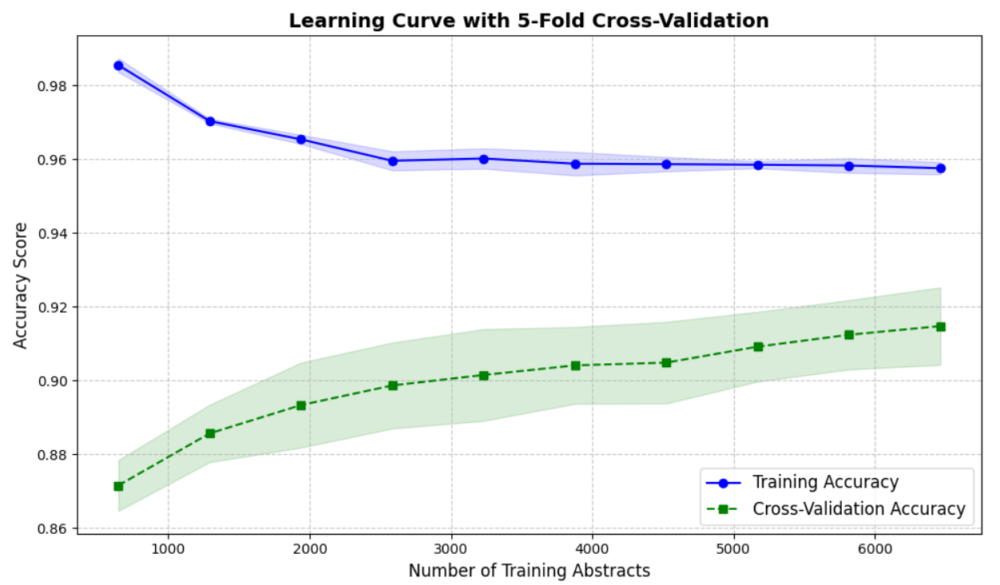
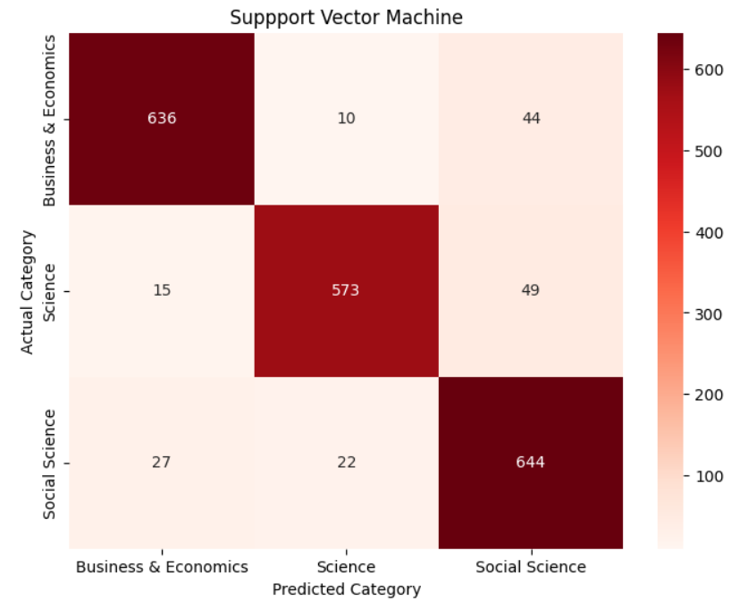

# Project-I: Research Article Classification

## Problem Statement
The objective of this project is to build a baseline Natural Language Processing (NLP) classification system capable of predicting the academic discipline of an input research article based solely on its abstract. The classification system categorizes peer-reviewed published content into three distinct fields:
1. **Science**
2. **Business & Economics**
3. **Social Science**

## Dataset
The dataset was ethically sourced from **Web of Science (WoS)** and consists of over 10,000 research abstracts. To ensure robust model training and avoid majority-class bias, the dataset is highly balanced across the three target categories:
- Social Science: ~3,467 abstracts
- Business & Economics: ~3,449 abstracts
- Science: ~3,183 abstracts

## Data Preprocessing & NLP Pipeline
To prevent data leakage and ensure the model learns true semantic relationships rather than dataset artifacts, a rigorous text cleaning pipeline was implemented using `NLTK` and `regex`:
- **Noise Reduction:** Stripped possessives, punctuation, and non-alphabetical characters.
- **Lemmatization & POS Tagging:** Words were mapped to their WordNet Part-of-Speech tags and lemmatized to their root forms.
- **Target Leakage Mitigation:** An extensive, custom stop-word list was developed to remove:
  * Explicit category proxies (e.g., "science", "business", "economics", "sociology").
  * Generic academic structural terms (e.g., "paper", "study", "research", "results", "abstract").
  * Publisher and dataset artifacts (e.g., "journal", "publish", "association").
- **Vectorization:** `TfidfVectorizer` was utilized with an `ngram_range` of (1,2) and a hard `max_features` limit of 5,000 to prevent the Curse of Dimensionality and model overfitting.

## Models Trained & Evaluation
Multiple machine learning classifiers were trained and compared using 5-Fold Cross-Validation. The performance was evaluated using Accuracy, Precision, Recall, and F1-Score metrics to ensure a holistic view of the models' predictive capabilities.

### Model Comparison (Evaluation Metrics)

| Classifier | Accuracy | Precision (Macro) | Recall (Macro) | F1-Score (Macro) |
| :--- | :--- | :--- | :--- | :--- |
| **Support Vector Machine (LinearSVC)** | **92.37%** | **0.93** | **0.92** | **0.92** |
| Logistic Regression | 92.12% | 0.92 | 0.92 | 0.92 |
| Random Forest | 88.56% | 0.89 | 0.89 | 0.89 |
| Multinomial Naive Bayes | 88.11% | 0.89 | 0.88 | 0.88 |
| K-Nearest Neighbors (kNN) | 87.42% | 0.87 | 0.87 | 0.87 |
| Decision Tree | 80.54% | 0.85 | 0.80 | 0.81 |

The **LinearSVC** model (with C=0.1) was selected as the final production model due to its superior generalized accuracy and excellent handling of the Bias-Variance tradeoff.

### Performance Interpretation & Visualizations

**1. Learning Curves (Bias-Variance Tradeoff)**
Learning curve visualizations were plotted across 5 folds to evaluate the optimal model. For the final `LinearSVC` model, the training accuracy (~95.5%) and cross-validation accuracy (~91.1%) converged smoothly. The flat trajectory at the upper limit of the training size proved the model successfully bypassed the Curse of Dimensionality and reached its maximum learning capacity without overfitting.


**2. Confusion Matrix Analysis**
A heat-mapped Confusion Matrix was generated on the hold-out test set to interpret misclassifications. The matrix revealed high true-positive accuracy across all three balanced classes. The minor off-diagonal errors (~8%) were heavily concentrated in interdisciplinary abstracts, representing the natural semantic noise threshold between intersecting research domains rather than an algorithmic failure.


**3. Filter Visualizations (Feature Importance)**
Bar charts of the top TF-IDF feature weights were extracted for each class to visualize what the model was actually learning. This filter visualization was critical for auditing the pipeline:
* *Target Leakage Discovery:* Early visualizations revealed the model was cheating by heavily weighting category labels (e.g., "economics", "sociology").
* *Semantic Isolation:* After aggressively expanding the stop-words list to filter out these leaks and publisher artifacts, the final visualizations proved the model was correctly drawing boundaries based on pure domain concepts (e.g., "microeconomics", "finance" for Business; "biology", "physics" for Science).

## Project Structure & Deliverables
- `NLP_project_research_article_classifier.ipynb`: The main runnable Jupyter/Colab notebook containing all data preprocessing, model training, evaluation metrics, and visualization code.
- `abstract_classifier.joblib`: The serialized, production-ready TF-IDF and LinearSVC pipeline.
- `processed_abstracts.xlsx`: The cleaned and labeled dataset used for training.
- `app.py`: The Streamlit application file for the interactive user demo.
- `README.md`: Project documentation and summary.

## How to Run the Demo
### For Demo run click here: [Research Article Classifier](https://research-article-classifier.streamlit.app/)

To run locally:
1. Ensure Python 3.8+ is installed.
2. Install the required dependencies:
   ```bash
   pip install pandas scikit-learn nltk streamlit joblib
   ```
3. Run the Streamlit application:
   ```bash
   streamlit run app.py
   ```
4. A browser window will open automatically. Paste your abstract into the text box and click "Classify" to see the model's prediction.